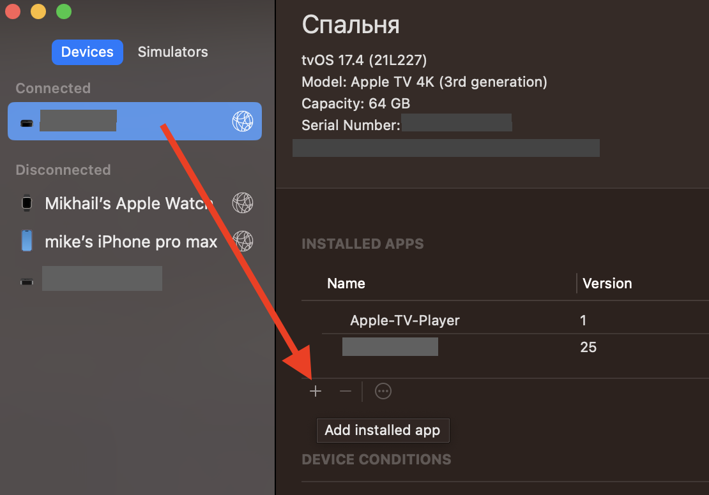
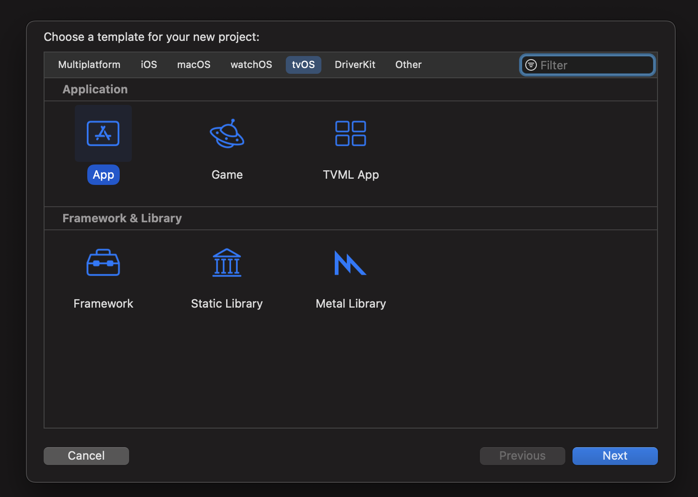
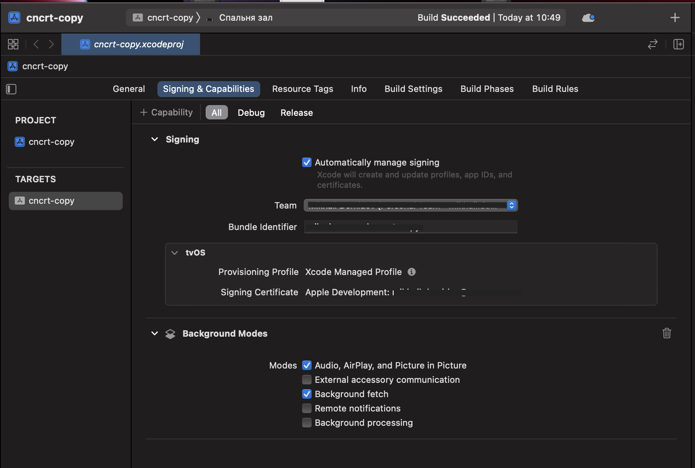
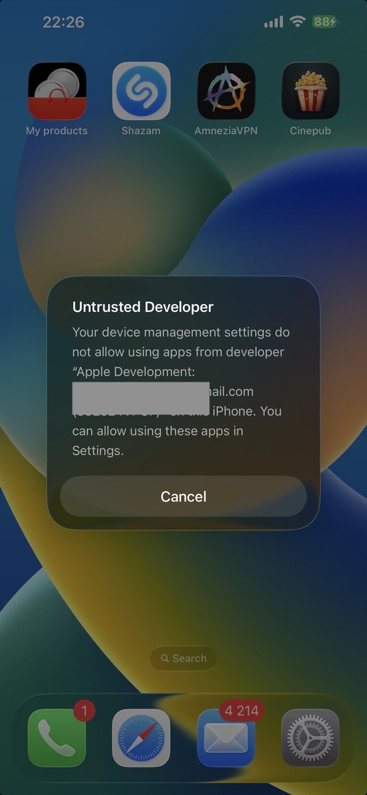

# Kinopub service .ipa resign automation

## Requirements

- MacOS
- ruby 3.2+
- bundler
- Apple Certificate installed in `Keychain Access` app

## Kinopub tvOS


## About

Original tvOS .ipa file taken from official telegram chat.

```bash
shasum -a 256 ./tvos/micro_tvOS-25_11.2023.ipa
```

should produce `0f91b1830684f28125b9bc4b2296fcf48f3d6cd5ffb5746e954822ff0c96e16d` hash.

## Install dependencies (see Gemfile)

```bash
bundle install
```

## Resign KinoPub tvOS .ipa file

- Call from the repo root directory. Must use an absolute file path.

```bash
bundle exec fastlane resign_ipa_tvos provision:/Users/$USER/Downloads/embedded.mobileprovision
```

- If you know what identity needed, you can pass it explicitly (or the script will search it through found certificates):

```bash
bundle exec fastlane resign_ipa_tvos identity:5EBCD74500DBE201A18629CDCE743303F47D0941 provision:/Users/$USER/Downloads/embedded.mobileprovision
```

### Result

On success, the result can be found at ./fastlane/resign/micro_tvOS-25_11.2023.ipa

### What it will do

1. It takes original Kinopub tvos .ipa file (./tvos/micro_tvOS-25_11.2023.ipa)
2. Unpacks it
3. Takes bundle id from your provided `mobileprovision` file and replaces Kinopub's one
4. Removes from Kinopub's application `Plugins` directory as not required
5. Repacks it back to .ipa
6. Uses `fastlane resign` tool (https://docs.fastlane.tools/actions/resign/) to resign .ipa file by provided `mobileprovision`

## Install .ipa tvOS

### Xcode way (simple Developer signature)

- Unpack generated ./fastlane/resign/micro_tvOS-25_11.2023.ipa (change .ipa extension to .zip and unzip it)
- Find there `./fastlane/resign/Payload/Kinopub.app` directory
- Open Xcode → Window → Devices and Simulators
- In the Devices section find your Apple TV
- Click `Add installed app` plus button
- Select there `./fastlane/resign/Payload/Kinopub.app` directory



### ideviceinstaller (simple Developer signature)

Install an app bundle directly to a device using `ideviceinstaller` from `libimobiledevice`

```bash
# find connected Apple TV 
idevice_id # 00008000-001A048C3A712345

# install an app to a device
ideviceinstaller --udid 00008000-001A048C3A712345 --install ~/Downloads/kinopub_app_resign/fastlane/resign/Payload/Kinopub.app
```

### Ad-Hoc Distribution Signature

- For this kind of distribution, you can install the app using .ipa file, send it to the device via AirDrop

## How to create .mobileprovision using Xcode (Free Developer Program)

1. Open Xcode
2. LogIn in Xcode using your Apple ID (Preferences → Accounts)
3. Create a new project

- File → New → Project
- Select there tvOS tab
- Select App



- Type your app bundle id
- Select your developer team

4. Be sure the device destination is set as your real paired Apple TV that Xcode is able to add its UUID to .mobileprovision file as you can use .mobileprovision with unknown device UUID. 



5. Build project (Product → Build)
6. Go to the build project directory (Product → Show Build Folder in Finder)
7. Find there in Products/Debug-appletvos/your-app-name.app/embedded.mobileprovision file

## KinoPub iOS and iPad App


```bash
shasum -a 256 ./ios/Cinepub_2.35-01052026.ipa # 8d370b9f196777dfc5c23c5af5c78b17ad88a57e6f3df5d9d8c8807230d7641b
```

## Resign the iOS App

```bash
bundle exec fastlane resign_ipa_ios provision:/Users/$USER/Downloads/embedded.mobileprovision
```

- With identity

```bash
bundle exec fastlane resign_ipa_ios identity:5EBCD74500DBE201A18629CDCE743303F47D0941 provision:/Users/$USER/Downloads/embedded.mobileprovision
```

### Result

On success, the result can be found at ./fastlane/resign/Cinepub_2.35-01052026.zip

### What it will do

1. It takes the original Kinopub iOS.ipa file (./ios/Cinepub_2.35-01052026.ipa)
2. Unpacks it
3. Takes bundle id from your provided `mobileprovision` file and replaces Kinopub's one
4. Removes from Kinopub's application `Plugins` directory as not required
5. Repacks it back to .ipa
6. Uses `fastlane resign` tool (https://docs.fastlane.tools/actions/resign/) to resign .ipa file by provided `mobileprovision`

## Install .ipa iOS / iPadOS

### Xcode way (simple Developer signature)

- Unpack generated ./fastlane/resign/Cinepub_2.35-01052026.ipa (change .ipa extension to .zip and unzip it)
- Find there `./fastlane/resign/Payload/Cinepub.app` directory
- Open Xcode → Window → Devices and Simulators
- In the Devices section find your Apple TV
- Click `Add installed app` plus button
- Select there `./fastlane/resign/Payload/Cinepub.app` directory


### ideviceinstaller (simple Developer signature)

Install an app bundle directly to a device using `ideviceinstaller` from `libimobiledevice`

### Ad-Hoc Distribution Signed

- For this kind of distribution, you can install the app using .ipa file, send it to the device via AirDrop

```bash
# find connected iPhone 
idevice_id # 00008000-001A048C3A712345

# install an app to a device
ideviceinstaller --udid 00008000-001A048C3A712345 --install ~/Downloads/kinopub_app_resign/fastlane/resign/Payload/Cinepub.app
```

### Untrusted Developer Warning



To fix this, go to Settings → General → VPN & Device Management → Developer App and click on the 'Trust $ {email}' button.

## How to create .mobileprovision using Xcode

The same way as for Kinopub tvOS, except use iOS Xcode App template and select there your real iOS device

----
## Run the KinoPub iOS app natively on Apple Silicon Mac

No Apple ID, provisioning profile or PlayCover needed. Tested on macOS 15.7 (M3 Max) with `Cinepub_2.35`.


Requirements: Apple Silicon Mac, Xcode (for the macOS SDK with iOS support).

```bash
./macos/build.sh   # builds /Applications/Cinepub.app from the newest ./ios/Cinepub_*.ipa
open /Applications/Cinepub.app
```

Optional arguments: `./macos/build.sh path/to/app.ipa path/to/Output.app`.

### What it does

1. Unpacks the iOS .ipa and removes the widget extension.
2. Retags the arm64 binaries as Mac Catalyst (`vtool`), so the app runs with an ad-hoc signature and SIP enabled.
3. Injects `CinepubFix.dylib` (sources in `./macos`) that works around issues of the iOS build on a Mac:
   - the device activation sheet crashes with `No Observable object of type ProxyManager found`: on a Mac SwiftUI presents it from a graph without the app's environment objects, so `@Environment(X.self)` lookups fall back to the instance the app injected;
   - auth tokens are not saved, because an ad-hoc signed app has no keychain entitlements: generic-password items are kept in `~/Library/Application Support/CinepubFix/keychain.plist` (mode 0600, plain text);
   - the layout is sized from `UIScreen.bounds` (the whole display): the app's own calls get the window size, and the title bar is hidden so the top safe area matches the iPad status bar.
   - text is small because iPad apps are drawn at 77% on a Mac: all fonts are scaled by 1.3
     (tune with `defaults write com.petrovich.cinepub CinepubTextScale -float 1.4`, then restart the app);
   - Escape goes back, like the `<` button.
   - a right click works as the iPad long press;
   - on the item page of Cinepub 2.35 the seasons (×1.5), episode cards (×2) and the trailer banner (×4.5 height)
     are enlarged to suit a Mac window. These code locations are pinned to that build and skipped for any other.
